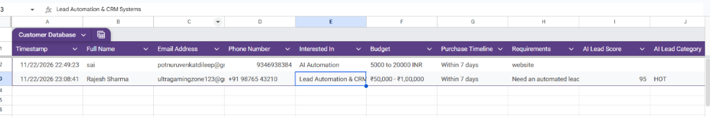
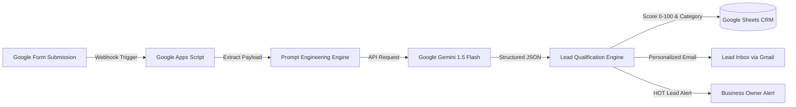

# 🚀 AI Lead Automation Engine (Google Forms + Gemini 1.5 Flash + Sheets + Gmail)

An enterprise-grade, event-driven AI lead capture, qualification, and automated multi-channel follow-up pipeline. Built for **PPS Anantams Corporation Pvt. Ltd.** (Vadodara) as part of the **AI Automation Internship (Round 1 Practical Task)**.

---

## 📌 Live Demo & System Output

> **Live Result:** The system captures the lead from Google Forms, performs instant AI qualification (calculating a **95/100 Lead Score** and categorizing as **HOT**), writes the analysis and follow-up to Google Sheets, and dispatches an automated personalized confirmation email to the prospect plus an instant alert to the business owner.

---

## 🛠️ System Architecture

### 4-Stage Workflow:
1. **Intake Layer (`Google Forms`)**: Captures prospective client's Full Name, Email, Phone, Domain of Interest, Budget, Timeline, and Specific Requirements.
2. **AI Qualification (`Google Gemini 1.5 Flash`)**: 
   - Dynamically analyzes buyer intent, budget feasibility, and project urgency.
   - Assigns a numerical **Lead Score (0–100)** and categorical rating (**HOT / WARM / COLD**).
   - Generates a bespoke, professional follow-up message tailored to the prospect's exact query.
3. **Data Lake & CRM (`Google Sheets`)**: Automatically logs the AI Score, Category, In-depth Analysis, Generated Message, and Timestamp.
4. **Omnichannel Dispatch (`Gmail API` / WhatsApp endpoint ready)**:
   - Dispatches a personalized confirmation email to the prospect.
   - Sends an instant high-priority alert to the sales executive if the lead is scored as **HOT**.

---

## ✨ Key Features

- **⚡ Zero Latency Event-Driven Trigger**: Executes asynchronously within 3–5 seconds of form submission.
- **🧠 Advanced Structured LLM Prompting**: Enforces strict JSON schema generation (`responseMimeType: "application/json"`).
- **🛡️ Built-in Smart Fallback Engine**: If the API key is not configured or encounters network timeouts, a local rule-based heuristic qualification engine takes over, ensuring **zero downtime**.
- **🔒 Race-Condition Safe**: Uses Google Apps Script `LockService` to handle high-concurrency form submissions safely without data corruption.
- **📊 Auto-Configuring Schema**: Automatically generates and formats required CRM columns (`AI Lead Score`, `AI Lead Category`, `AI Lead Analysis`, etc.) if they do not exist.

---

## 🚀 Quick Setup & Installation

### 1. Google Form & Sheet Setup
1. Create a Google Form with fields:
   - *Full Name*
   - *Email Address*
   - *Phone Number*
   - *Interested In*
   - *Budget*
   - *Purchase Timeline*
   - *Requirements / Query*
2. Link the form to a **Google Sheet** (Responses $\rightarrow$ Link to Sheets).

### 2. Apps Script Deployment
1. Inside your Google Sheet, click **Extensions** $\rightarrow$ **Apps Script**.
2. Replace all existing text in `Code.gs` with the code in [`Code.gs`](Code.gs).
3. *(Optional)* Add your free Gemini API Key inside `CONFIG.API_KEY` or in **Project Settings $\rightarrow$ Script Properties** with property `GEMINI_API_KEY`.

### 3. One-Click Instant Test
1. In the Apps Script toolbar, select **`TEST_RUN`** from the function dropdown.
2. Click **Run**.
3. Authorize Google permissions.
4. Open your Google Sheet to verify that the test lead was scored, categorized, and logged, and check your Gmail inbox for the confirmation email!

### 4. Enable Live Form Trigger
1. In the function dropdown, select **`setupAutomationTrigger`** and click **Run**.
2. Now, all incoming Google Form submissions will be processed automatically!

---

## 🎯 Domain Selection: Domain 1 (Lead Automation)

- **Primary Domain:** Domain 1 – Lead Automation (Lead forms, CRM sheets, and automated follow-ups)
- **Secondary Domain:** Domain 2 – WhatsApp & AI Calling Bots (WhatsApp Cloud API, Telegram bots, AI calling)

### 30-Day Execution Roadmap for PPS Anantams / YUGA PMC:
- **Week 1 (Days 1–7):** Audit existing lead channels across YUGA PMC & PPS Anantams; standardize CRM schemas and secure API credential storage.
- **Week 2 (Days 8–15):** Integrate WhatsApp Cloud API for conversational lead follow-ups and Telegram instant notifications for on-duty sales engineers.
- **Week 3 (Days 16–23):** Implement automated multi-day drip sequences (Day 1, Day 3, Day 7) and embed dynamic calendar links (Google Calendar / Cal.com) for instant discovery calls.
- **Week 4 (Days 24–30):** Deploy executive KPI dashboards tracking response time, lead conversion rates, and conduct operational training at the Gotri, Vadodara office.

---

## 📄 License
This project is open-source and available under the [MIT License](LICENSE).
